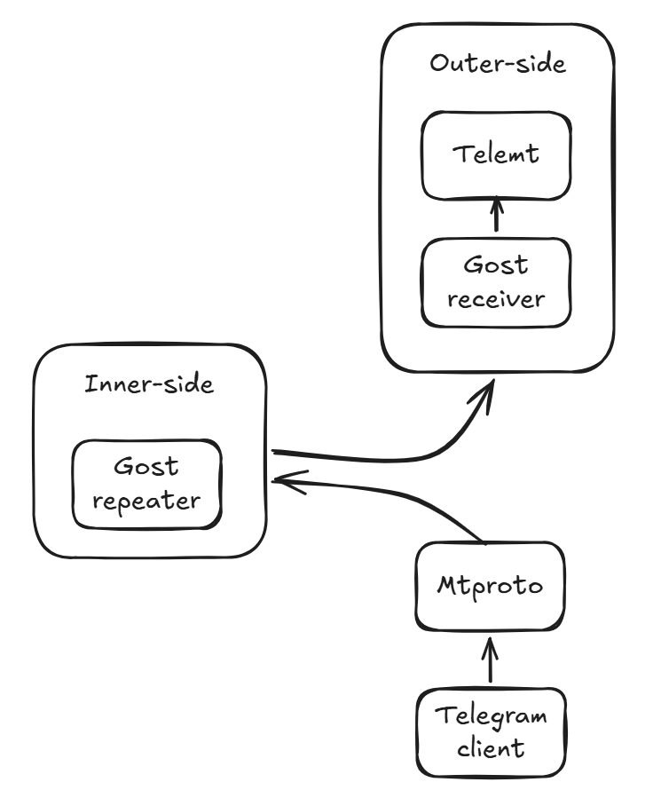
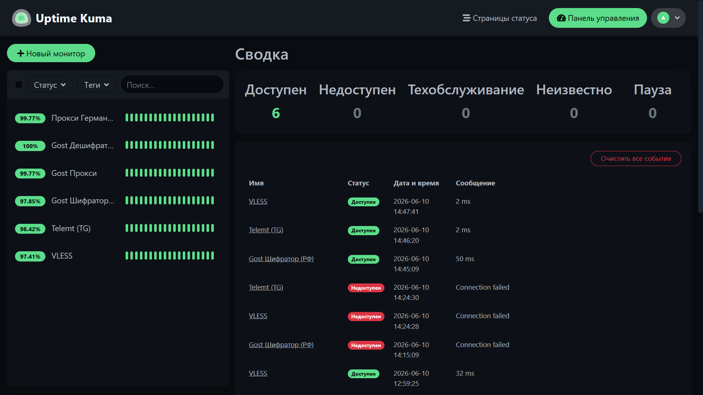

# Двухсерверная инфраструктура прокси и VPN

Репозиторий содержит готовую конфигурацию для развертывания защищенной сетевой инфраструктуры. Проект разделен на две части: **внутренний сервер** и **внешний сервер**.

## 🔨 Архитектура системы

### Сам проект поделен на две части:

- **`inner-side`** — предназначена для стабилизации работы MTProto-прокси Telegram в сетях со строгими политиками маршрутизации. Располагается на дополнительном сервере или локально на ПК. Выступает мостом между клиентом и прокси-сервером.
  > Возможно, после обновления MTProto командной Telegram и изменения его паттернов поведения необходимость во втором сервере исчезнет.

- **`outer-side`** — часть проекта, расположенная вне сети со строгими политиками маршрутизации. Большинство технологий проекта расположено на ней.

### Технологии, используемые в сборке:

1. **Telegram — шифрованный мост MTProxy (GOST + Telemt):**
   - Клиент подключается к IP `inner-side` на порт `9030`.
   - **GOST-bridge** принимает трафик, оборачивает его в шифрованный Shadowsocks-туннель и передает на `outer-side`.
   - **GOST-receiver** расшифровывает поток и локально пересылает его в контейнер **Telemt** на порт `9030`.
   - **Telemt** обрабатывает MTProto-трафик и связывается с серверами Telegram.
   - Такая схема позволяет дополнительно защитить транспорт MTProxy от обнаружения по сигнатурам на международных стыках провайдеров.

2. **Telegram WEB Proxy (Telemt + NGINX):**
   - Дополнительный способ подключения Telegram через HTTPS.
   - Telemt принимает WEB-подключения на внутреннем порту `18080`.
   - **NGINX** принимает HTTPS-подключения на порту `443`, завершает TLS и передает запросы в Telemt.
   - Для подключения используется доменное имя, например `lightspot.example.com`, с настроенным SSL-сертификатом.
   - Публичный адрес WEB-прокси имеет вид `https://ДОМЕН/telegram/web/`.
   - Для WEB-прокси не требуется `inner-side`: подключение идет напрямую к внешнему серверу.
   - WEB-прокси работает независимо от классического MTProxy и не заменяет его.

3. **Классический прокси (GOST):** традиционный HTTP/SOCKS5-прокси на порту `9000` с авторизацией по логину и паролю. Данные указываются в `.env`.

4. **Мониторинг (Uptime Kuma):** панель для контроля доступности всех сервисов с поддержкой оповещений в Telegram. Расположена на порту `9050`.

---

## 📁 Структура репозитория

```text
├───inner-side
│       .env
│       docker-compose.yml
│
└───outer-side
    │   .env
    │   docker-compose.yml
    │
    ├───config
    │   ├───kuma
    │   ├───nginx
    │   │       default.conf
    │   └───telemt
    │           telemt.toml
    └───site
            index.html
```

---

## 🚀 Старт и развертывание

- Главная часть проекта — `outer-side`, является обязательной.
- `inner-side` нужен для конфигураций telemt, где обычного подключения к `outer-side` недостаточно из-за особенностей сети пользователя.
- Telegram WEB Proxy работает напрямую через внешний сервер и не требует развертывания `inner-side`.

### Итоговая схема подключения MTProxy через inner-side



### Требования к серверам

Два сервера с установленными Docker и Docker Compose.

**Inner VPS:**
- Свободный порт `9030`.

**Зарубежный VPS:**
- Порты `80` и `443` — сайт и Telegram WEB Proxy через NGINX.
- Порт `9000` — HTTP/SOCKS5 GOST.
- Порт `9020` — GOST Shadowsocks receiver.
- Порт `9050` — Uptime Kuma.

Порт `18080` используется WEB-listener Telemt внутри Docker-сети и не должен быть открыт во внешний интернет. Порт `9030` Telemt также используется внутри Docker-сети для классического MTProxy.

> Если в конфигурации Xray используется тот же внешний порт `443`, что и у NGINX, необходимо развести их по разным портам или настроить совместный TLS-вход. Два контейнера не могут независимо занимать один и тот же IP:443.

---

## Шаг 1. Настройка и запуск Inner-сервера

1. Перейдите в каталог `inner-side/`:

   ```bash
   cd inner-side/
   ```

2. Создайте файл переменных среды `.env` на основе примера:

   ```bash
   cp .env.example .env
   nano .env
   ```

3. Заполните переменные:

   - `OUTER_SIDE_IP` — публичный IP-адрес зарубежного сервера.
   - `OUTER_SIDE_PORT` — `9020` (порт, на котором зарубежный GOST принимает туннель).
   - `GOST_PASSWORD` — надежный пароль для шифрования межсерверного туннеля.

4. Запустите мост:

   ```bash
   docker compose up -d
   ```

---

## Шаг 2. Настройка и запуск зарубежного сервера

1. Перейдите в каталог `outer-side/`:

   ```bash
   cd outer-side/
   ```

2. Создайте файл переменных среды `.env`:

   ```bash
   cp .env.example .env
   nano .env
   ```

3. Заполните переменные:

   - `PROXY_LOGIN` — логин для общего HTTP/SOCKS5-прокси.
   - `PROXY_PASSWORD` — пароль для общего HTTP/SOCKS5-прокси.
   - `GOST_PASSWORD` — пароль для шифрования туннеля (должен строго совпадать с паролем на Inner-сервере).

4. Для Telegram WEB Proxy дополнительно потребуется:
   - Доменное имя, указывающее A-записью на публичный IP внешнего сервера.
   - SSL-сертификат для этого домена.
   - Корректно настроенный NGINX, принимающий HTTPS на `443` и проксирующий путь `/telegram/web/` на `telemt:18080`.

   В конфигурации Telemt домен и путь должны совпадать с настройками NGINX. Например:
   - Домен: `example.com`.
   - Путь: `/telegram/web/`.
   - Публичный адрес: `ПУБЛИЧНЫЙ_IP:443`.

5. Запустите зарубежную часть инфраструктуры:

   ```bash
   docker compose up -d
   ```


## Подключение клиентов

### 1. Подключение к Telegram MTProxy через inner-side

Для подключения мессенджера используйте ссылку:

```text
tg://proxy?server=<IP_INNER_SIDE>&port=9030&secret=<SECRET>
```

Ссылку Telemt выведет при запуске сервера, но там может быть указан локальный IP-адрес. В таком случае замените его на публичный IP `inner-side`.

Для просмотра вывода запуска:

```bash
docker compose up
```

### 2. Подключение к Telegram WEB Proxy

WEB Proxy позволяет подключить Telegram напрямую к внешнему серверу через HTTPS, без `inner-side`.

Для работы необходимы:
- Доменное имя, направленное на публичный IP внешнего сервера.
- Действующий SSL-сертификат для этого домена.
- NGINX с поддержкой HTTP/2 на публичном порту `443`.
- WEB-listener Telemt на внутреннем порту `18080`.

Ссылка для подключения генерируется Telemt автоматически при запуске. Она имеет следующий формат:

```text
tg://webproxy?server=<ДОМЕН>%2Ftelegram%2Fweb&secret=<WEB_SECRET>
```

Например, если домен `lightspot.example.com`, ссылка будет содержать:

```text
server=lightspot.example.com%2Ftelegram%2Fweb
```

**Важно:**
- В ссылке используется домен, а не IP-адрес сервера.
- Порт `443` отдельно указывать не нужно.
- Путь `/telegram/web` должен совпадать с `base_path` в `telemt.toml` и маршрутом NGINX.
- При изменении домена, пути или секрета необходимо использовать заново сгенерированную ссылку.
- WEB Proxy — отдельный тип прокси в Telegram. В документации Telemt заявлена совместимость с Telegram Desktop и типом подключения WEB; поддержку конкретных мобильных клиентов следует проверять отдельно.

### 3. Подключение к общему HTTP/SOCKS5-прокси

Для использования в браузерных расширениях или прикладном ПО:

- **Адрес:** `ЗАРУБЕЖНЫЙ_IP`
- **Порт:** `9000`
- **Тип:** `HTTP` или `SOCKS5`
- **Авторизация:** ваши `PROXY_LOGIN` и `PROXY_PASSWORD`.

### 4. 📊 Мониторинг инфраструктуры

Панель мониторинга Uptime Kuma доступна по адресу:

```text
http://<ЗАРУБЕЖНЫЙ_IP>:9050
```

При первом входе вам будет предложено выбрать базу данных (оставьте значение по умолчанию — SQLite) и создать учетную запись администратора.

Из панели можно настроить отправку моментальных уведомлений в ваш Telegram-чат при падении любого из звеньев сети. Для этого требуется создать бота через @BotFather и получить API-ключ, который указывается в панели Uptime Kuma.

Также возможна кастомизация сообщений об изменении статуса прокси с помощью эмодзи, шаблонов и других параметров.

### Пример настроенного Uptime Kuma


